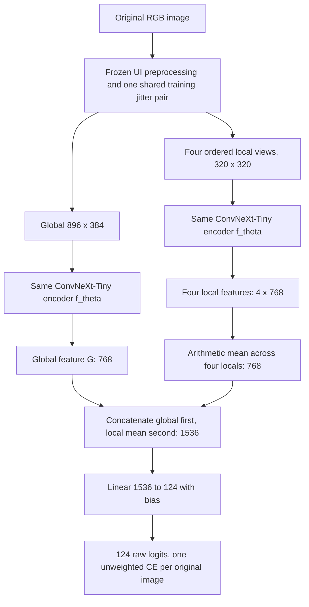

# E2 — Shared-Encoder Global/Local Representation

**E2-G0 APPROVED — corrected specification, plan and task ledger reviewed by the user. E2-T00b numeric-contract candidate preparation only is complete. E2-G1 is PASS; native E2-T01?T10 implementation/CPU preparation is authorized. Target and later execution stages remain NOT AUTHORIZED. Final test remains LOCKED / NOT AUTHORIZED.**

Revision date: **2026-11-05**. E1 training/validation is closed. The user has confirmed completion of E1-HR and PASS for HR-G2/HR-G3a/HR-G3b; its three-seed validation reports are available. This specification takes that handoff as given. Earlier preparation-status text in the master/E1-HR documents does not override the current user handoff, and this document does not revise their frozen contracts or approval records.

On 2026-11-05 the user explicitly approved the current corrected E2 specification, [implementation plan](plan.md) and [task ledger](tasks.md) at **E2-G0**, authorizing **E2-T00b only**. The complete [numeric-contract candidate](e2_numeric_contract_v1.json) is prepared for separate E2-G1 review. This approval does not freeze the candidate, create a checksum sidecar or approval receipt, authorize implementation or CPU/GPU tests, permit target work, create tuning/final declarations, launch jobs, start E3, or unlock test evaluation. An approved earlier experiment does not supply E2 acceptance or execution authorization.

## 1. Research question, scope, and source authority

**Does a shared-encoder representation combining global scene context with four deterministic local views improve country/territory classification on the same fixed benchmark?** E2 implements the global/local architecture already defined by the study roadmap. It is not a continuation of E1-HR training or a search over crop geometry/fusion designs.

| Experiment | Inputs per original image, width × height | Representation before classifier | Classifier |
|---|---|---|---|
| E1 | Global 896×384 | 768-dimensional global feature | Linear(768,124), bias=True |
| E1-HR | Global 1344×576 | 768-dimensional global feature | Linear(768,124), bias=True |
| E2 | Global **896×384** and **4 local 320×320** | **[global; mean of four locals]**, 1536 dimensions | **Linear(1536,124), bias=True** |

**E1 is E2's primary architectural comparator**, because both use the same global input at 896×384. E2 adds local views, feature fusion, a wider classifier, and encoder computation relative to E1. **E1-HR is a contextual/complementary comparator**: it supplies the study's higher-resolution global-only context. E2 versus E1-HR must not be interpreted as controlled evidence isolating local views or resolution. E2 gains cannot be attributed exclusively to local detail, head capacity, or compute from these comparisons alone. Compute matching is not a requirement. Report all five study metrics together; no new single winner metric or minimum improvement threshold is introduced.

Apply the following authorities to their respective scopes:

1. The current user instruction and E1-HR handoff establish the present stage and permission to prepare this document.
2. The [master specification](../master_spec.md) and [design review record](../grillme.md) define E2's shared encoder, global/local geometry, fusion, independent initialization, natural training, and equal tuning protocol. Their older unresolved numeric/status registers do not reopen decisions subsequently settled in the completed methodology.
3. The [E1 numeric contract](../E1/e1_numeric_contract_v1.json), SHA-256 `c9153c53534e95099c374e8ab7b54bc347588f11b200adcc92b3c23ad6ac4143`, and [reviewed R1–R9 decisions](../E1/t00_review.md) define the common training controls. The [E1 closeout](../E1/closeout_review.md) supplies the completed baseline methodology.
4. The [E1-HR numeric contract](../E1-HR/e1hr_numeric_contract_v1.json), SHA-256 `e23fa67e1f41c7bea43446e44961a215ca488aac72ae21f5e56395e097c0a35d`, and [reviewed design](../E1-HR/plan.md) supply completed stage-isolation, source-identity, gate, and per-attempt recovery conventions. They are references, not E2 execution contracts.
5. The [frozen preprocessing specification](../preprocessing_v1.md), [configuration](../../configs/preprocessing/geoguessr_v1.json), [runtime module](../../src/preprocessing/geoguessr_v1.py), and [split provenance](../../artifacts/baseline124/provenance.json) are the input authorities.
6. The [pilot report](../../reports/pilot/pilot_results.md), archived E2 [P0 configuration](../../reports/pilot/evidence/uit_2026-10-31/p0/e2/config_resolved.json)/[summary](../../reports/pilot/evidence/uit_2026-10-31/p0/e2/run_summary.json), and [P1 configuration](../../reports/pilot/evidence/uit_2026-10-31/p1/e2/config_resolved.json)/[history](../../reports/pilot/evidence/uit_2026-10-31/p1/e2/history.json)/[summary](../../reports/pilot/evidence/uit_2026-10-31/p1/e2/run_summary.json) support feasibility and timing only. [Pilot model source](../../src/pilot/models.py) documents the reference view-batching order; it is not an official runtime dependency or a source of official scores.

Outside scope: separate encoders, random/content-adaptive crops, alternative crop counts/resolutions, local positional embeddings, weighted/learned fusion, extra normalization/projection/fusion MLP/attention, auxiliary local losses, balancing, strong augmentation, LLRD, extra LR candidates/seeds, E3 training/caching, and test evaluation. These choices are not additional ablations to implement.

## 2. Fixed inputs and integrity

Reuse `baseline124-v1` artifacts byte-for-byte from source commit `33cb29d72974f1677efab0f56ed92360e5a9f712`. The ordered `labels.json` indices are label IDs 0–123. Split seed 406 is historical provenance, not an instruction to regenerate membership or a training-seed default.

| Split | Unique original images | GT-supported labels | E2 access |
|---|---:|---:|---|
| train | 34997 | 124 | Training and authorized train-only diagnostics |
| val | 7497 | 106 | Full validation, checkpoint/LR selection, reporting |
| test | 7502 | 111 | Metadata only; image bytes prohibited |
| Total | 49996 | 124 output labels | Fixed membership |

The raw collection contained 49997 images, with one byte duplicate removed for this fixed split. Geographic/panorama independence has not been established. Preserve extreme-tail labels, exact membership, label names, and support counts.

| Fixed artifact | Exact bytes | SHA-256 |
|---|---:|---|
| `artifacts/baseline124/manifest.csv` | 7519661 | `9cbd8b70e8522b5aa4a20fba4fa7b2ecea855cf377f98e41ebb162a07f8a8040` |
| `artifacts/baseline124/summary.json` | 994 | `cf3dcf909aefd17c531cd115d6c30e54bbeb3dbd13962f974317ccde8a2f3e4b` |
| `artifacts/baseline124/labels.json` | 1927 | `5f7e8f5810e9ac8c43c1c22b2e4febe2e7a6174629b9031d3e943fce511832aa` |
| `artifacts/baseline124/class_support.csv` | 6308 | `ff46f4074464644f573b4ca64eb61320a61a8cc3daed3a3886a350cbc3c6fb75` |

Before model allocation, verify these bytes/hashes, manifest consistency, label IDs/support, unique membership, safe root-contained paths, and current train/validation image integrity. Missing/corrupt samples, unrecognized layouts, root escapes, and label mismatches fail with a recorded error; no skipping or replacement. A current conformance/hash-audit binding must cover all **34997 train + 7497 validation images**, without reading test bytes. Keep the data immutable after audit; changed root/content/packages require the relevant audit/conformance checks again.

Reject test split/image access before file opening. Reading test membership/counts as metadata does not grant access to images, previews, predictions, or test-derived selection signals. Section 14 applies throughout E2.

## 3. Frozen five-view preprocessing

Use preprocessing ID **`geoguessr-ui-global-local-v1`** and the existing `Preprocessor(experiment="e2", global_wh=(896,384))` interface unchanged.

| Input authority | Exact SHA-256 |
|---|---|
| `configs/preprocessing/geoguessr_v1.json` | `4f49dd41738168cfc65d4322fbe1b659ef5595229bb487ad86dd671a26a8903f` |
| `src/preprocessing/geoguessr_v1.py` | `4d1dea328f69c1c7e1fa4f333c7276de0c3bc81b322db40dc33530969357e666` |

The runtime-read preprocessing checksum sidecar must also match. The configuration's per-layout integer `local_crops_xywh` rectangles are authoritative. The table below describes their established geometry; it does not create a second coordinate implementation.

| Decoded raw WH | Frame after footer removal | Raw local crop size | Global output | Four local outputs |
|---|---|---|---|---|
| 1536×662 | 1536×648 | 384×384 | 896×384 | 320×320 each |
| 1030×703 | 1030×689 | 402×402 | 896×384 | 320×320 each |

For each original image:

1. Decode with Pillow and convert to RGB without EXIF transposition; accept only the two frozen layouts. Convert through `pil_to_tensor(...).to(float32).div(255.0)` on CPU, with no intermediate uint8 requantization.
2. Remove the bottom 14-pixel footer and construct the valid-scene mask from the frozen static UI rectangles. Navigation arrows intentionally remain; some embedded watermarks may remain.
3. During training, draw **one pair** of independent brightness/contrast factors in `[0.9,1.1]`, amplitudes 0.10/0.10. Apply brightness then contrast to valid scene pixels on this shared raw float tensor; exclude UI pixels from statistics. Use the frozen contrast grayscale weights `[0.2989,0.587,0.114]` and formulas. Fill masked UI with exact float32 ImageNet mean afterward.
4. Construct the global view from that processed raw tensor using aspect-preserving centered letterbox to 896×384. Resize by CPU float32 TorchVision tensor bilinear with `antialias=True`; use `floor(value+0.5)` rounding and put any extra padding pixel on the right/bottom.
5. Extract all four local crops **directly from that same processed raw tensor**, in configuration order: `left`, `middle_left`, `middle_right`, `right_raised`. Resize each square directly to 320×320 with the same backend. Do not crop the resized global, a letterboxed canvas, or a separately jittered image.
6. Normalize every view after construction with mean `[0.485,0.456,0.406]`, std `[0.229,0.224,0.225]`, `inplace=False`. UI and padding fills use the exact float32 mean before normalization, never rounded uint8 colors. Preserve antialiased scene/UI boundaries without re-masking.

Per-image output is `global: [3,384,896]`, `local: [4,3,320,320]`. Global letterbox content/padding remains 896×378 with L/T/R/B 0/3/0/3 for the large layout, and 574×384 with 161/0/161/0 for the small layout. Use the config for runtime values; never recompute rectangles from relative centers, rescale templates, reject uninformative crops, or reorder locals.

The same photometric pair affects scene pixels in every view. Five views do not receive five independent jitter draws. Validation is deterministic with augmentation disabled. No flips, random crops, RandAugment, Random Erasing, Mixup/CutMix, label smoothing, test-time augmentation, `weights.transforms()`, PIL resize, or System.Drawing training resize is allowed.

## 4. Shared representation, fusion, and initialization



The two encoder boxes denote **one parameter set**, used for both paths. For a view `v`, preserve the TorchVision ConvNeXt-Tiny feature extractor, global average pooling, and pretrained final LayerNorm, then flatten to `f_theta(v) ∈ R^768`. Apply the final LayerNorm to each view's pooled feature before local averaging. No new post-fusion normalization or projection is added.

```text
G       = f_theta(global)                                  # [B,768]
L_all   = f_theta(local.flatten(0,1)).reshape(B,4,768)        # [B,4,768]
L_mean  = L_all.mean(dim=1)                                 # [B,768]
F_fused = concatenate([G,L_mean], dim=1)                     # [B,1536]
logits  = Linear(1536,124,bias=True)(F_fused)                 # [B,124]
```

Preserve the reference execution order: **global encoder call first**, then **one encoder call over all `B*4` locals**. Local flattening is batch-major: the four config-ordered crops of image 0, then image 1, and so on. Reshape back without exchanging images/crops. This is two encoder calls per microbatch, not five optimizer steps. Training stochastic depth consumes RNG according to these batch shapes and call order; per-crop loops, different chunking, independent encoders, or reordered calls are not interchangeable official implementations.

At full microbatch, global input is `[2,3,384,896]`, local input `[2,4,3,320,320]`, internal local encoder batch `[8,3,320,320]`, and logits `[2,124]`. At the retained one-image tail, the corresponding leading dimensions are 1, 1, 4, and 1. Both feature paths remain differentiable through the local mean and fused CE; do not detach, freeze, or use `no_grad` on either path during training. Evaluation uses `model.eval()` and no gradient recording.

Use the same pinned pretrained identity:

- Enum: `torchvision.models.ConvNeXt_Tiny_Weights.IMAGENET1K_V1`.
- Offline filename: `convnext_tiny-983f1562.pth`.
- Full SHA-256: `983f1562536e84ff750a1576fb08e54de751dbf2e17c0d8a4a13704341fdcd3d`.
- Verify exact filename, existence, and full digest before strict loading into the original ImageNet architecture. Retain its representation and replace only the ImageNet linear classifier with the new fused classifier. No automatic substitute/download or non-strict partial load.

Every tuning/final run starts independently from those ImageNet weights with a new optimizer/scheduler. E1/E1-HR/pilot checkpoints, another LR trial, and the selected tuning model are forbidden initialization sources. A later attempt of the **same declared run** restores its own `last.pt` under Section 10.

The new E2 head inherits `linear_default`, with its actual **fan-in 1536**:

```text
weight: kaiming_uniform_(a=sqrt(5))
bias:   uniform(-1/sqrt(1536), +1/sqrt(1536))
seed:   official seed of this run, inside an isolated CPU RNG context
```

Restore the outer CPU RNG state after head construction/initialization. Do not copy E1's fan-in 768 bound, add a second unreviewed head reset, or reuse classifier state. Full fine-tuning begins at epoch 1. Retain TorchVision 0.23.0's block-index stochastic-depth schedule from 0 to maximum 0.1; evaluation disables stochastic depth. No classifier-only phase, LLRD, local heads, or auxiliary CE.

The following exact parameter counts are **design/acceptance oracles**, not observations or official future results:

| Component | Required oracle |
|---|---:|
| Fused classifier `Linear(1536,124,bias=True)` | **190,588** parameters: `1536*124 + 124` |
| Complete E2 model | **28,010,716** parameters |

E2-T00b must serialize both counts. E2-T03 must verify them on the actual specified architecture, and E2-T11 must verify them on the real pinned-weight target model. A mismatch fails model/acceptance verification and detects duplicated backbones, a wrong head, extra projections, or other unintended parameters; do not adjust the oracle to fit an implementation.

## 5. Common training controls and exact accounting

These inherited controls are requirements carried forward from the completed methodology, not a new optimization menu. The architecture-specific changes are the five-view representation, fused head/fan-in, and corresponding view execution contract above. Their E2 binding was reviewed at E2-G0 and is serialized in the candidate for separate E2-G1 digest/freeze review; this specification is not a freeze receipt.

| Control | E2 requirement |
|---|---|
| Effective batch | **2 original images** |
| Microbatch / accumulation | **2 original images / 1**; `drop_last=False` |
| Train sampling | Natural shuffled permutation without replacement; all 34997 original images exactly once per completed epoch |
| Updates per epoch | **17499** microbatches/optimizer updates, including one final image |
| Scientific budget per run | **8 epochs, 8 full validations, 139992 optimizer updates** |
| Training termination | Early stopping OFF; no patience/min-delta stopping; selected checkpoint does not shorten the run |
| Loss | One standard unweighted fused CE per original image; `label_smoothing=0`; no class weights/balancing |
| Optimizer | AdamW; betas `[0.9,0.999]`; eps `1e-8`; head LR multiplier 1; no LLRD |
| Weight decay | 0.05 for trainable Conv/Linear weights; 0 for biases, LayerNorm parameters, and ConvNeXt layer-scale parameters |
| Gradient clipping | OFF |
| Validation | All 7497 images in fixed manifest order after every completed training epoch; no shuffle/jitter |
| Numerics | Deterministic FP32 under Section 8 |

The 17499 updates are `ceil(34997/2)`, not a count over 174985 individual views. The five views of one screenshot share one label and one sample loss. With actual group size `D`, backpropagate summed CE divided by **D original images**; for the retained tail D=1. Do not divide by five or apply separate per-view losses. Report sample-mean train loss and validation NLL, never an unweighted average of batch means.

Enumerate actual model parameters into decay groups: every trainable tensor appears exactly once, shared encoder parameters are not duplicated by view use, and unexpected categories/omissions fail. All groups use the same base LR and schedule. Nonfinite logits/loss/gradients or OOM fail and are recorded; no silent skipped sample/update, AMP fallback, microbatch change, view chunking, or reduced resolution/budget.

## 6. Exact eight-epoch scheduler

For candidate base LR `L`, zero-based optimizer update `u`, `N=139992`, `W=1000`, and floor `f=1e-6`:

```text
u < W:   LR(u) = L * (0.1 + 0.9*u/W)
u >= W:  LR(u) = f + (L-f)/2 * (1 + cos(pi*(u-W)/(N-W-1)))
```

Apply LR before update `u`; advance completed-update state only after that optimizer update. Update 0 uses `0.1L`, update 1000 uses `L`, and update 139991 uses exactly `1e-6`. Validation advances no scheduler state; reject updates beyond the original budget. Preserve this full horizon across all attempts, all four tuning candidates, and all three final seeds. Do not reset warmup, shorten the horizon to the selected epoch, use the pilot's three-epoch horizon, or extend completed training.

## 7. Independent E2 LR tuning and final seeds

The common LR grid and training IDs are fixed:

```text
LR candidates = [2.5e-5, 5e-5, 1e-4, 2e-4]
tuning seed  = 1001
final seeds  = [2001, 3001, 4001]
```

The tuning seed is disjoint from the three distinct final seeds. Neither pilot seed 3406 nor split seed 406 is an official training seed. Equal numeric seeds across architectures enable paired reporting; they do not imply identical head weights, stochastic-depth draws, or learning dynamics.

Run **exactly four LR trials × one tuning seed**, each completing all eight epochs/eight validations under its original budget. E2's selected LR is unknown until this campaign finishes. E1's selected LR `1e-4`, E1-HR's selected LR `5e-5`, and the pilot diagnostic LR are comparators/history, not E2 defaults or official selections.

Within a run, use supported-validation Macro-F1 on the **[0,1] scale**, with `tau=1e-6`. Select the first completed epoch initially; subsequently replace only when `current_metric - selected_metric > tau`. Otherwise retain the earlier checkpoint. Do not use NLL/Top-k as tie-breakers or select another epoch for another reported metric. The chronological comparator is not interchangeable with a global-maximum-within-tolerance checkpoint rule.

Across the four **valid, full-budget** trial selected-checkpoint scores, compute their global maximum `M`. A candidate is eligible exactly when `M-score <= 1e-6`; select the **lowest base LR** among eligible candidates. This LR comparator is separate from checkpoint selection even though both use the same numeric tolerance. Trial enumeration order and sequential pairwise tolerance comparisons must not change LR selection.

Publish all four candidates, histories, selected epochs/scores, checkpoint identities, and failures/retries. A failed/incomplete candidate cannot be ignored, replaced by a fifth LR, or counted as a successful equal-budget result. Resume an interrupted candidate only under its same declaration; if a valid complete outcome cannot be produced, stop for explicit user review.

**STOP after the complete tuning handoff and locked E2 LR selection.** E2-G3b must separately authorize final training. Only then run the selected configuration with seeds 2001/3001/4001, each freshly initialized and completing eight epochs/eight validations. No automatic tuning-to-final launch, seed search, cherry-picked seed, or replacement of the specified aggregate with an ensemble.

## 8. RNG, loaders, and deterministic runtime

Inherit the exact E1/E1-HR stream definitions. Seed Python with `random.seed(seed)`, NumPy with `seed % 2**32`, Torch CPU with `torch.manual_seed(seed)`, and all CUDA RNGs with `torch.cuda.manual_seed_all(seed)`.

Derived seeds use UTF-8 pipe-separated `str` values, starting with the official seed and followed by key parts; hash with SHA-256, take the first eight bytes little-endian, and reduce modulo `2**63-1`. Do not use Python's built-in hash or add an E2/view key to the inherited order/jitter streams.

| Stream | Required mechanics |
|---|---|
| Epoch order | Fresh CPU generator keyed `(seed, zero_based_epoch, "order")`; `torch.randperm(dataset_length)` |
| Shared image jitter | Fresh CPU generator keyed `(seed, zero_based_epoch, manifest_relative_path, "jitter")`; two sequential scalar uniform draws, brightness then contrast |
| Loader generators | Separate CPU generators keyed `(seed, "loader", "train")` and `(seed, "loader", "val")`; save/restore both states |
| Workers | Torch worker seeds from the loader generator; seed worker Python/NumPy with `torch.initial_seed()%2**32`; carry epoch in sampled indices for persistent workers |
| Model stochastic depth | Accepted global-first, flattened-locals-second execution in Section 4; save/restore all relevant Torch RNG states |

Use epoch indices 0–7 internally and report epoch numbers 1–8. Jitter depends on image/epoch identity, not worker completion order. Reconstruct persistent workers on resume without advancing logical loader-generator progression beyond the uninterrupted reference.

FP32 is mandatory. AMP, GradScaler, TF32 matmul/cuDNN, and `torch.compile` are OFF. Set float32 matmul precision `highest`, cuDNN benchmark=false/deterministic=true, deterministic algorithms=true with warn_only=false. Use `num_workers=2`, `pin_memory=true`, `persistent_workers=true`, `prefetch_factor=2`, and CPU threads=2. Verify effective settings and reject overrides that enable TF32.

Before Python startup, export `PYTHONHASHSEED=<official run seed>`, `OMP_NUM_THREADS=2`, `MKL_NUM_THREADS=2`, and `CUBLAS_WORKSPACE_CONFIG=:4096:8`.

| Software | Inherited target lock |
|---|---|
| Python | 3.11.17 |
| Torch / TorchVision | 2.8.0+cu128 / 0.23.0+cu128 |
| Pillow / NumPy | 11.3.0 / 2.1.3 |
| pandas / scikit-learn | 2.2.3 / 1.6.1 |
| CUDA / cuDNN | 12.8 / 91002 |

These are execution requirements, not a claim that the current target has been inspected. Record actual software, effective runtime, device/driver, and allocation. The historical pilot driver is a reference rather than an unconditional driver lock. Material differences require review and E2 acceptance under the actual conditions; do not silently adopt a different environment or treat local CPU packages as target evidence.

## 9. Separate E2 target acceptance

E2 requires its own CPU/preparation review and **separately authorized target/GPU acceptance**. E1/E1-HR acceptance, user-confirmed HR gates, archived E2 P0/P1, and CPU fixtures do not replace E2 target acceptance. This is a bounded execution/integrity check, not another optimization trial or a new pilot branch.

Acceptance must establish, on the actual consumed source/runtime/device/data/weights:

- Exact input hashes, current root-contained train/validation audit/conformance, real pinned pretrained weights, and the effective FP32/runtime settings before official execution.
- Frozen preprocessing on real **train-only** representatives of both layouts, shared image jitter, exact local ordering/from-raw construction, and batch shapes **global `[2,3,384,896]`, local `[2,4,3,320,320]`, logits `[2,124]`**. Also verify the retained one-image tail.
- One shared encoder, per-view final LayerNorm, the local mean, concatenation order, fused feature `[B,1536]`, correct head initialization, complete decay groups, and finite forward/backward through both global and all local paths under one fused CE. Verify exactly **190,588 classifier parameters and 28,010,716 total E2 parameters** against the Section 4 design/acceptance oracles.
- Interrupted-boundary/resume equivalence: restore a completed boundary, discard/replay uncommitted epoch work, and match the uninterrupted model, optimizer, scheduler, RNG, loader/order, history, and selected-checkpoint progression on the same deterministic stack. Timing/job audit fields are not numerical-equality targets. Bounded acceptance fixtures remain explicitly nonofficial and receive no official epoch/update credit.
- Observed allocated/reserved memory and timing with clearly named measurement scope, interruption/failure records, and the acceptance source/harness inventories defined in Section 11.

Acceptance cannot depend on beating an E1/HR validation score or reaching a pilot throughput threshold. No automatic search over batch, precision, crop execution, or optimizer settings is permitted. Only a **material E2 target-acceptance failure that prevents correct execution of the specified protocol** may trigger explicit user review of an inherited control; review does not itself approve a change. Minor operational failures do not reopen scientific controls.

## 10. Slurm attempts and completed-epoch recovery

Use the inherited UIT deployment reference: partition `normal`, account `uit`, QoS `mig2-35`, GRES `gpu:2g.35gb:1`, one task, four CPUs, 16384 MiB RAM, expected NVIDIA H200 MIG 2g.35gb, and **09:00:00 per job attempt**. Record actual allocation compatibility; require no fixed MIG UUID. Target GPU work belongs only inside its separately authorized Slurm allocation.

Retain the reviewed interpreter `/datastore/binhvp/BuiTrongTan/CS406/envs/cs406/bin/python`, dataset root `/datastore/binhvp/BuiTrongTan/CS406/data/geoguessr`, and pinned weight path `/datastore/binhvp/BuiTrongTan/CS406/pretrained/convnext_tiny-983f1562.pth`. E2 run/evidence roots must be separate from E1/E1-HR, for example `runs/E2` and `reports/E2` under the same project root; exact execution paths are bound in the later reviewed declarations.

Archived E2 P0 measured **4321.36 seconds per full training epoch**, excluding validation/checkpoint I/O. Eight times that measurement is approximately **9.60 hours of training alone**, an extrapolation rather than an observed official E2 run. P1 epoch timings include train/validation but exclude subsequent checkpoint/history writes. Neither record establishes that eight official epochs fit inside nine hours. Plan for multiple attempts without increasing the scientific budget or automatically choosing longer walltime.

- One attempt serves **one declared run**. One run may need several attempts. No architecture/LR/seed/batch loop belongs inside a single attempt.
- The declaration, source/runtime/input identity, seed, LR, original eight-epoch horizon, and run directory remain immutable across attempts. Use a single writer and atomic checkpoint replacement.
- Commit boundary zero and **completed-epoch boundaries after full validation, history, and checkpoint selection are consistent**. `last.pt` is the authoritative full-state resume artifact. A failed write preserves the previous readable committed boundary.
- If an attempt terminates during an epoch or before its boundary is committed, discard that uncommitted work and **replay the entire epoch from its beginning** using the previous committed `last.pt` of the same run. Restore model, optimizer, full scheduler position/horizon, inactive-scaler policy, Python/NumPy/CPU/all-CUDA RNG, loader generators, epoch/order, history, selected checkpoint metadata and selected weights.
- Never resume from reporting-only `best.pt`, another run's checkpoint, E1/E1-HR/pilot state, or an implicitly fresh replacement. Do not reset warmup, add epochs/updates, count replay twice, or extend a completed run. A complete run is not runnable again as extra training.
- Record attempt IDs, start/end committed boundaries, outcomes, failures, reviewed retries, and replay work with its measurement scope. Unknown uncommitted work is recorded as unknown. Retry/requeue handling follows the later reviewed runbook and authorization; no automatic resubmission or walltime extension is granted here.

## 11. E2 identity, source closure, and evidence

Every E2 declaration, resolved configuration, checkpoint, run summary, LR selection, analysis, and aggregate must bind:

```text
experiment = E2
global_wh = [896,384]; local_wh = [320,320]; local_count = 4
local order; global-first / batch-major flattened-local encoder execution
feature = [global; mean(local_1..local_4)], dimension = 1536
stage; seed; base LR; original epoch/update budget
E2 contract digest; accepted scientific/runtime identity
fixed data/label/preprocessing/pretrained fingerprints
declaration/config/checkpoint/history/selection lineage
test_images_opened = 0
```

Use explicit E2 run IDs, such as `e2-{stage}-lr{lr:.8f}-seed{seed}`, with stage-specific kinds/output roots/receipts. E2 contracts and checkpoints must not pass as E1 or E1-HR artifacts. A later versioned E2 numeric contract must serialize all exact requirements and provenance, then receive its exact-byte sidecar and digest-bound approval only after explicit E2-G1 approval. Do not embed a contract's own digest inside itself or fabricate future hashes/observations.

### Scientific/runtime fingerprint

The accepted source fingerprint is the canonical hash of an **explicit reviewed repository-relative path → exact-byte SHA-256 map** of consumed scientific/runtime files. Include production E2 modules affecting declaration/preflight/data/model/training/checkpoint/runtime behavior; actually reused `src/e1/engine.py`/`src/e1/metrics.py` mechanics; package markers required by actual imports; exact `src/preprocessing/geoguessr_v1.py`; its frozen config and runtime-read sidecar; relevant dependency files `requirements.txt`/`pyproject.toml`; and the official E2 Slurm wrapper if it controls the launch environment.

Review actual transitive imports and consumed files before acceptance. Enumerate paths explicitly; no broad `src/preprocessing/*.py`, source-directory wildcard, silent omission, or invented hash for nonexistent E2 code. A reporting-only module is outside training identity unless actually imported by the training path. Contract, dataset, weights, conformance, and approval receipts retain their separate exact integrity bindings regardless of membership in this source map.

### Acceptance/test and audit inventory

Capture acceptance-only harnesses, including the future `tests/e2/test_gpu_smoke.py`, relevant fixture/helpers, and acceptance outputs in a separate immutable audit inventory with exact path, bytes, SHA-256, and role. Reporting tools have their own audit inventory. These are not automatically part of scientific/runtime source equality. An unrelated test-only edit does not invalidate an unchanged accepted scientific runtime; a correction that undermines an acceptance proof requires evidence review.

Record the actual **clean Git commit and cleanliness** at acceptance and every official attempt as audit metadata. Scientific equality across acceptance/runs/resume is determined by consumed-source hashes, E2 contract, software/effective runtime, reviewed device/driver/allocation policy, current dataset root/content, fixed input fingerprints, and accepted conformance bindings. It is **not repository-commit equality**. A docs-only or test-only clean commit remains eligible when those bindings are unchanged. Operational job IDs/MIG UUIDs also belong in audit records rather than scientific equality keys.

**Any consumed runtime/scientific file change requires renewed E2 target acceptance.** Full immutable configuration, stage permissions, accepted evidence/receipt hashes, and same-run checkpoint/history/selection checks remain mandatory. Source-closure separation does not weaken these checks or permit cross-run resume.

Preserve declarations, resolved configs, parameter-group/init metadata, eight-epoch histories, `best.pt`/`last.pt`, all attempts/failures/retries, four-trial ledger, locked selection, selected validation analyses, three-seed report, and scoped checksum inventories. Validate declaration ↔ summary ↔ history ↔ checkpoint ↔ selection ↔ report lineage rather than trusting caller-supplied scores.

## 12. Implementation constraints for later planning

Keep future production/test packages lowercase and E2-specific, such as `src/e2/` and `tests/e2/`. Reuse unchanged numerical mechanics only where their interfaces fit. Existing E1/E1-HR epoch loops expect a single tensor and call `.to(device)` on it; an E2 batch has global **and** local tensors. The E2 design must explicitly handle both transfers, original-image loss denominators, prediction paths, and tail shapes. Blindly re-exporting the single-view loop is not a multi-view implementation.

The reviewed plan must define this boundary and its behavioral verification before coding. Do not alter completed E1/E1-HR contracts, scientific artifacts, identity validators, or frozen preprocessing to accommodate E2. Do not import pilot code at runtime or build a generic permanent training framework. Reused numerical modules and necessary package initializers enter E2's consumed-source closure.

CPU verification and deployment preparation precede separately authorized target work. Later verification must cover both-layout five-view preprocessing/shared jitter, batching and fusion order, one shared encoder and gradient paths, fan-in 1536 initialization, optimizer enumeration, exact schedule endpoints/accounting, checkpoint/LR comparators, deterministic workers and replay, stage/identity rejection, test guards, and regression protection of completed stages. None of that implementation or test execution is performed by this specification-writing task.

## 13. Validation reports, comparisons, and E3 handoff

Use the same definitions as completed E1/E1-HR:

- Top-1/3/5 rank **all 124 original logits**, descending, with ascending label ID for exact ties; never perturb logits to break ties.
- Supported Macro-F1 averages full-validation per-class F1 over the **106 GT-supported classes**. Unsupported F1 is null/excluded; supported classes with no correct predictions receive zero. Weighted-F1 uses validation GT support. NLL is diagnostic sample-mean unweighted CE.
- Frequency buckets use unique fixed-split `n_train`: 1–19, 20–99, 100–499, ≥500, plus the 1–2 subset. Compute bucket Macro-F1 from per-class F1 on the **entire validation split**, retaining cross-bucket false positives. Bucket Top-k conditions on GT bucket membership while ranking all outputs. No-support metrics are null.
- Export selected-checkpoint overall metrics, 124-label precision/recall/F1/GT support/predicted counts, coverage, fixed bucket tables, manifest-keyed predictions/Top-k, confusion/most-confused pairs, complete histories/learning curves, and all selection/identity lineage.
- Require all three complete distinct final seeds under the same locked selection/contract. Aggregate arithmetic mean and **sample standard deviation, ddof=1**, using full machine precision. Display classification percentages and their standard deviations to four decimals, with no pre-aggregation rounding.

Use **reviewed official comparator aggregate artifacts materialized/provided in the execution environment**, with explicitly supplied actual paths. Do not assume they exist at repository-relative source/report paths on branch `e2`. Verify their exact file-byte SHA-256 before using them:

| Official aggregate | Comparator role | Required exact SHA-256 |
|---|---|---|
| E1 | **Primary architectural comparator**; same global input 896×384 | `3387477c40a97388e967f10fd74d313664946d0b7ec1ae963ad0e49a98b3db9e` |
| E1-HR | **Contextual/complementary comparator** | `9cb44e8aa98d18065402ea3be750586187aeb4b0e4ff23cfa6badfcc484426cf` |

Record the actual supplied paths and verified hashes in reporting provenance; no unprovided path or additional artifact/hash is presumed. Missing artifacts or hash mismatches block the comparison/closeout rather than falling back to a repository path, pilot result, or best comparator seed. Verify the reviewed artifact schemas and matching fixed benchmark/metric definitions. Optional paired deltas join matching seed IDs, use percentage-point units, and do not establish significance from three seeds alone. Label E2-versus-E1 as the primary architectural comparison and E2-versus-E1-HR as contextual; the latter does not isolate local views or resolution.

E2-T00b must serialize **E1 as the primary architectural comparator**, **E1-HR as the contextual/complementary comparator**, and **both exact comparator hashes above** as required scientific/reporting bindings. The future numeric-contract candidate must also serialize the Section 4 parameter-count oracles as JSON integers: classifier **`190588`** and total E2 **`28010716`**. Missing or swapped roles, missing or incorrect hashes, and missing or incorrect counts make the candidate incomplete for E2-G1 review; prose references or report-time defaults do not satisfy this requirement. E2-T09 reporting and E2-T14 closeout must enforce those bindings. Comparator report paths remain explicitly supplied execution-environment inputs, not assumed branch contents or numeric-contract path defaults.

The Section 4 parameter-count checks are mandatory design/acceptance verification, not optional efficiency measurements or future observed results. Other efficiency information is secondary if measured: FLOPs with explicit input/view assumptions, latency, original-images/s, peak allocated/reserved memory, and clearly separated train-only, validation/checkpoint, attempt, and whole-run timing. Views/s is not original-images/s. Do not infer compute matching or official timing from archived pilot measurements.

Document fixed-split geographic/panorama limitations, extreme-tail scarcity, seed/sampling uncertainty, and validation-only scope. E2 need not outperform a comparator to be a valid completed experiment. E2 selected LR, selected epochs, metrics, actual job IDs, checkpoint hashes, and runtime acceptance hashes are **future outputs**, not fields to invent in this draft.

For later E3, preserve each final seed's selected E2 checkpoint and the exact pre-classifier **1536-dimensional `[G; mean(L)]`** feature definition, with final LayerNorm and view order unchanged. E3 will use deterministic evaluation-mode features with jitter/stochastic depth disabled and no gradient updates to the representation. This is a compatibility requirement only; no cache, head reset/retraining, cRT job, or E3 numeric protocol is authorized here.

## 14. Study-wide final-test lock

**Final-test access is LOCKED / NOT AUTHORIZED throughout E2 specification, planning, implementation, acceptance, LR tuning, final training, validation analysis, and closeout.** Read only test metadata; reject image access before opening files. Add no test evaluator or test-based architecture/LR/epoch/augmentation/geometry selection in this stage.

Final-test evaluation may be considered only after **all experiments intended for the final comparison, including E3 if retained in the study, have frozen protocols/checkpoints and closed their intended train/validation work**, followed by separate explicit user authorization of final evaluation. E1-HR completion, E2 final-seed approval, or E2 closeout does not grant that permission. The old pipeline's historical test inspection is not erased; do not describe the benchmark test as never previously seen.

## 15. Approval gates and handoff

| Gate / stage | Required decision or deliverable | Current state |
|---|---|---|
| E2-G0 | Review this E2 specification, inherited controls, five-view execution/head contract and corrected plan/ledger; authorize remaining numeric-contract preparation | **PASS — explicit user approval on 2026-11-05; E2-T00b only** |
| Design preparation | Corrected [plan](plan.md)/[task ledger](tasks.md), followed by numeric-contract candidate with exact values, source/provenance bindings and numerical oracles | **E2-T00b COMPLETE — CANDIDATE/DOCUMENTATION ONLY**; [candidate JSON](e2_numeric_contract_v1.json) prepared and checked; awaiting E2-G1 |
| E2-G1 | Review prepared artifacts; approve exact contract digest/freeze, select implementation method, explicitly authorize the named implementation/CPU-preparation scope | **NOT APPROVED** |
| Implementation / CPU preparation | Complete only the E2-G1-authorized tasks, scoped regressions, and deployment/runbook preparation; stop before target work | Not authorized |
| E2 target-work authorization | Explicitly permit E2 Slurm/GPU deployment and bounded target acceptance | **NOT GRANTED** |
| E2 target acceptance | Execute Section 9 under that authorization; bind actual consumed source/runtime/device/data/weights and recovery evidence | Not started |
| E2-G2 | Review CPU/regression and target acceptance, accepted identity, and the concrete four-trial declarations | **NOT APPROVED** |
| E2-G3a | Explicitly authorize exactly four E2 tuning trials under the reviewed declarations | **NOT GRANTED** |
| Tuning handoff / STOP | Four valid full-budget outcomes, complete ledger, and locked LR selection; present for user review | Not started |
| E2-G3b | Review the tuning handoff and explicitly authorize the three declared final-seed runs | **NOT GRANTED** |
| E2 closeout | Review three completed final runs, selected validation analyses, aggregate/comparisons, lineage/checksum inventory, and handoff to E3 | Not started |
| Final evaluation | Separate study-wide explicit authorization under Section 14 | **LOCKED / NOT AUTHORIZED** |

The E2-T00b candidate is **86,335 bytes**, exact SHA-256 **`ef8767460bbd54454baa22ce289ed4222742954bcdefa8024a8972f5dc958f72`**. JSON, inherited controls, numerical arithmetic/oracles, source-reference hashes and comparator bindings were checked as documentation only. No E2 checksum sidecar, approval receipt, official declaration, accepted target identity or result was created. The candidate records the exact pre-status-update G0-reviewed document snapshots; later ledger/status changes do not rewrite that provenance or create a digest cycle. Selected E2 LR/results and accepted runtime hashes remain future outputs. **STOP for explicit E2-G1 review of the exact candidate digest, implementation method and named scope.**

## E2-G1 approval record (2026-11-05)

E2-G1 is **PASS**, explicitly approved by the user for exact contract SHA-256 `ef8767460bbd54454baa22ce289ed4222742954bcdefa8024a8972f5dc958f72` at reviewed commit `c40dd00a22de2d3ef50440440107d66db7b7dc45`. The approved JSON bytes remain unchanged; the exact-byte sidecar and [G1 receipt](e2_g1_approval.json) record the freeze. Native task-by-task **E2-T01?T10 only** is authorized, with CPU RED ? GREEN ? scoped regression and commits. Earlier preparation-status text and frozen candidate snapshots are historical. Target/GPU work, target acceptance, tuning, finals, E3 and test images remain **NOT AUTHORIZED**. STOP after T10.
